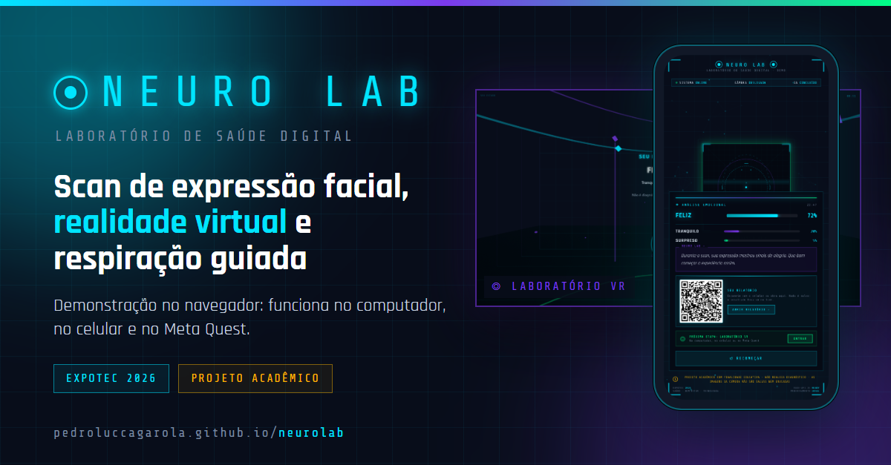
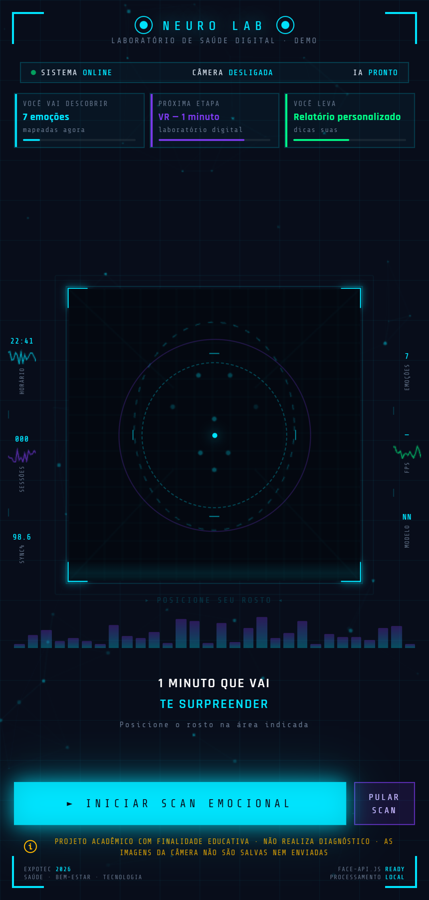
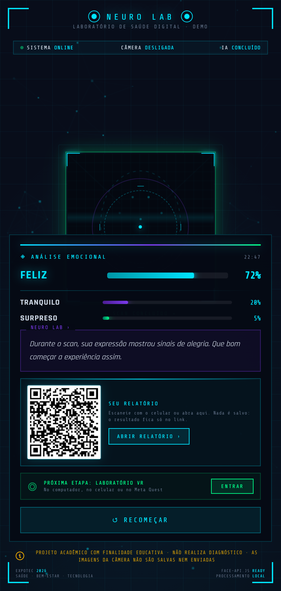
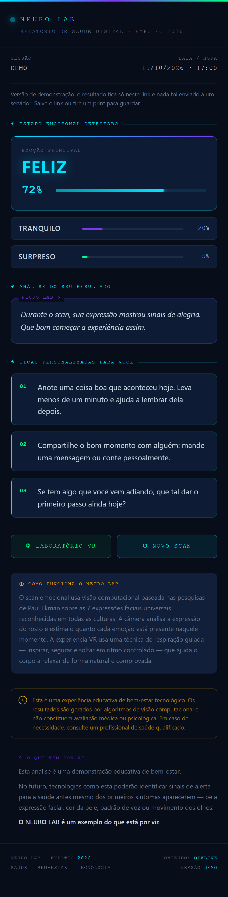
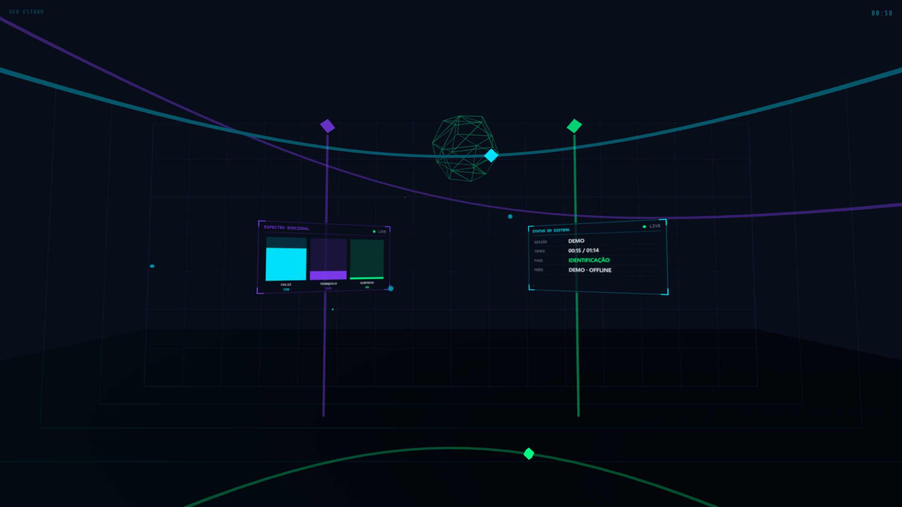
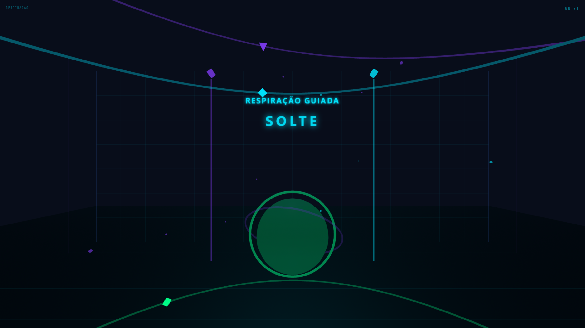

# NEURO LAB — Laboratório de Saúde Digital



O **NEURO LAB** é um projeto acadêmico desenvolvido para a **EXPOTEC 2026 da FORTEC**, com o tema saúde, bem-estar e tecnologia. A experiência tem três etapas:

1. **Scan de expressão facial:** a webcam estima, no próprio navegador, a presença de 7 expressões faciais (alegria, tranquilidade, surpresa, tristeza, irritação, apreensão e desconforto).
2. **Laboratório em realidade virtual:** um ambiente 3D de cerca de um minuto, com narração e respiração guiada no ritmo 4-4-6 (inspirar 4 s, segurar 4 s e soltar 6 s), acompanhando uma esfera de luz.
3. **Relatório de bem-estar:** o resultado do scan e três dicas práticas, em linguagem simples, abertos no celular pelo QR code.

Na feira, o projeto funcionou com um servidor Node.js no notebook e com o Meta Quest 3S. Este repositório traz uma **versão de demonstração** que funciona sem servidor, para qualquer pessoa testar pelo navegador, e preserva a **versão usada na feira** na pasta [`versao-feira/`](versao-feira/).

> **Aviso:** projeto acadêmico com finalidade educativa. Não realiza diagnóstico. As imagens da câmera são processadas no próprio aparelho e não são salvas nem enviadas.

## Demonstração online

**https://pedroluccagarola.github.io/neurolab/**

| Tela inicial | Resultado | Relatório |
|---|---|---|
|  |  |  |

| Laboratório VR | Respiração guiada |
|---|---|
|  |  |

*As porcentagens das capturas são valores de exemplo.*

## Como usar

1. Abra o link da demonstração.
2. Escolha uma das opções:
   - **Iniciar scan emocional:** o navegador pede permissão para usar a câmera. Posicione o rosto na área indicada e aguarde a contagem. A câmera é desligada logo após a captura.
   - **Pular scan:** para quem não quer ou não pode usar a câmera. Basta escolher uma emoção para seguir a demonstração.
3. No painel de resultado:
   - **Abrir relatório** mostra o relatório nesta tela; o **QR code** abre o mesmo relatório no celular.
   - **Entrar** abre o laboratório em realidade virtual.
4. No laboratório VR, clique em **Entrar no laboratório** com o som ligado:
   - **Computador:** arraste com o mouse para olhar ao redor.
   - **Celular:** gire o aparelho ou arraste com o dedo.
   - **Meta Quest:** abra o link no navegador do Quest; a sessão entra em VR imersivo.
5. Ao final, a tela de encerramento leva ao relatório.

O resultado fica apenas no endereço (URL) do relatório e do VR, por exemplo `relatorio/?e=happy:72,neutral:20,surprised:5`. Nenhum dado é gravado em servidor.

## Tecnologias utilizadas

**Versão de demonstração (raiz do repositório)**

| Tecnologia | Uso |
|---|---|
| HTML, CSS e JavaScript (sem framework) | Interface, relatório e lógica da experiência |
| [face-api.js](https://github.com/justadudewhohacks/face-api.js) 0.22.2 (TensorFlow.js) | Detecção do rosto (Tiny Face Detector) e estimativa das expressões (Face Expression Net), executadas no navegador |
| [A-Frame](https://aframe.io/) 1.5.0 (three.js) e WebXR | Laboratório 3D e modo imersivo no Meta Quest |
| Web Audio API | Narração do VR e efeitos sonoros do scan |
| [qrcodejs](https://github.com/davidshimjs/qrcodejs) 1.0.0 | QR code do relatório, gerado no navegador |
| Fontes Rajdhani e Share Tech Mono | Identidade visual (arquivos locais) |
| GitHub Pages | Hospedagem estática |

A narração foi gerada previamente em MP3 com [edge-tts](https://github.com/rany2/edge-tts) (voz pt-BR-FranciscaNeural), pelo script `versao-feira/gerar_narracao.py`.

**Versão da feira ([`versao-feira/`](versao-feira/))**

| Tecnologia | Uso |
|---|---|
| Node.js e Express | Servidor local: páginas, sessões, relatório e painel coletivo |
| Android Platform Tools (`adb reverse`) | Conexão do Meta Quest 3S ao servidor pelo cabo USB-C |
| cloudflared (Cloudflare Tunnel) | Endereço público temporário para o QR code abrir o relatório no celular do visitante |
| Meta Quest 3S (navegador do Quest) | Experiência em realidade virtual |

O servidor da feira tem integração opcional com a API da Anthropic para gerar o texto do relatório. Na feira, porém, o relatório usou o conteúdo offline já escrito (`api/fallback.json`), que é o mesmo usado na demonstração.

## Estrutura do repositório

```
neurolab/
├── index.html            Tela do scan (HUD)
├── js/
│   ├── scan.js           Detecção de expressões com face-api.js
│   └── conteudo.js       Textos do relatório e leitura do resultado na URL
├── relatorio/index.html  Relatório de bem-estar
├── vr/
│   ├── lab.html          Laboratório VR (A-Frame)
│   ├── audio/            Narração em MP3
│   └── lib/              A-Frame 1.5.0
├── lib/                  face-api.js, qrcodejs e fontes
├── models/               Modelos do face-api.js
├── docs/                 Capturas, capas e carrossel
└── versao-feira/         Versão apresentada na EXPOTEC 2026 (servidor Node.js)
```

## Executar localmente

A demonstração precisa ser aberta por um servidor HTTP (os modelos e os áudios são carregados por requisição). Na pasta do projeto, use um dos comandos:

```bash
npx serve .
# ou
python -m http.server 8080
```

Depois abra `http://localhost:8080` (ou o endereço indicado). A câmera só é liberada pelo navegador em `localhost` ou em endereços `https`.

Para executar a versão da feira, veja [`versao-feira/INICIAR_NEURO_LAB.md`](versao-feira/INICIAR_NEURO_LAB.md). Ela precisa de `npm install` e das ferramentas `adb` e `cloudflared` na pasta `versao-feira/tools/`, que não estão no repositório por serem programas de terceiros.

## Equipe

| Papel | Integrantes |
|---|---|
| Desenvolvimento | Pedro Lucca |
| Ideias e apresentação na EXPOTEC | Carlos Eduardo, Iori e Kauã |

## Como foi desenvolvido

O código foi escrito com o **Claude** como principal ferramenta de desenvolvimento. Pedro Lucca definiu a experiência, conduziu as etapas do desenvolvimento, testou cada versão, identificou os erros e tomou as decisões do projeto.

## Principais problemas resolvidos

**Conexão do Meta Quest sem rede compartilhada.** O Quest precisava abrir o laboratório VR servido pelo notebook, mas não havia garantia de uma rede compartilhada entre os dois: redes de escola costumam bloquear a comunicação entre aparelhos. A solução foi conectar o Quest por cabo USB-C e usar `adb reverse tcp:3000 tcp:3000`: o Quest acessa `localhost:3000` e a conexão chega ao servidor do notebook pelo cabo, sem depender do Wi-Fi. O script `INICIAR_FEIRA.bat` automatiza o processo (localiza o Quest entre os dispositivos USB, executa o `adb reverse` e desativa o sensor de proximidade para a tela não apagar entre visitantes). Como o Quest sempre abre o mesmo endereço, o botão **Entrar** do computador registra no servidor qual sessão deve ser exibida no óculos.

**Calibração da emoção neutra.** Com o rosto em repouso, o modelo tende a apontar "neutro" como emoção principal, mesmo quando há sinais leves de outra expressão. Foram definidas três regras: as demais emoções recebem um peso de 1,5 apenas para a ordenação; "neutro" só fica em destaque com pelo menos 70%; e outra emoção só assume o destaque com pelo menos 15%. As porcentagens exibidas continuam sendo as calculadas pelo modelo, e o resultado é a média de várias leituras seguidas.

**Linguagem acessível no relatório.** O relatório precisava ser entendido por visitantes de qualquer idade. Os textos do relatório, do painel e da narração falam em "sinais na expressão" em vez de afirmar o que a pessoa sente, evitam termos técnicos e diagnósticos e oferecem dicas práticas para aplicar no mesmo dia.

## Privacidade

- O vídeo da webcam é analisado pelo face-api.js no próprio navegador. Nenhum quadro é gravado, exportado ou enviado pela rede.
- A câmera só é ligada ao clicar em **Iniciar scan emocional** e é desligada logo após a captura.
- O resultado (apenas as porcentagens) fica no endereço do relatório; não há banco de dados nem servidor na demonstração.
- Os dados das sessões da feira não fazem parte deste repositório.

## Aviso

O NEURO LAB é um projeto acadêmico com finalidade educativa. Não realiza diagnóstico e não substitui avaliação médica ou psicológica. Em caso de necessidade, procure um profissional de saúde qualificado.

## Créditos de terceiros

face-api.js (MIT), A-Frame (MIT), qrcodejs (MIT), fontes Rajdhani e Share Tech Mono (SIL Open Font License) e modelos pré-treinados distribuídos com o face-api.js.
